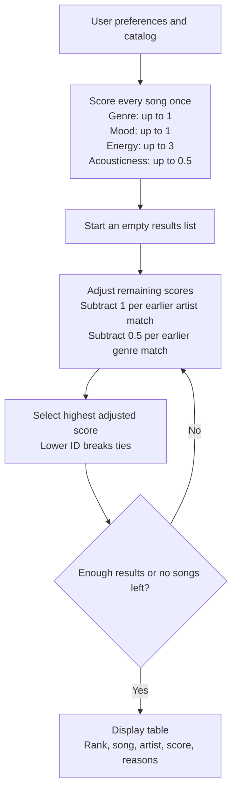

# 🎵 Music Recommender Simulation

## Project Summary

VibeMatch 1.0 recommends five songs from a catalog of 18 fictional tracks.
It compares the listener's genre, mood, energy, and optional acoustic preference.
It then reduces scores for repeated artists and genres to encourage variety.
The terminal shows an ASCII table with each song's adjusted score and reasons.

I tested seven profiles, changed the scoring weights, and compared the results.
The project shows how simple rules can suggest music and still miss parts of a listener's taste.
See the [model card](model_card.md) for the data, limitations, and evaluation results.

### Optional Features Implemented

- **Diversity and Fairness Logic:** Reduces a candidate's score by 1 point for
  each already-selected song by the same artist and 0.5 points for each in the
  same genre. This encourages variety without banning repeats or guaranteeing fairness.
- **Visual Summary Table:** Displays recommendations in an ASCII table with
  rank, song, artist, score, and reasons. Long text wraps, and diversity penalties
  appear alongside the other score contributions. No extra library is needed.

---

## Designing the Simulation: Define Your Data

The original catalog contains 10 songs across pop, lofi, rock, ambient, jazz, synthwave, and indie pop. Its moods are happy, chill, intense, relaxed, moody, and focused. Energy ranges from 0.28 to 0.93 on a 0.0–1.0 scale, where higher values mean greater intensity.

### Dataset expansion prompt

```text
Generate 8 additional fictional songs for a music recommendation simulation.
Return only valid CSV with this exact header and column order:
id,title,artist,genre,mood,energy,tempo_bpm,valence,danceability,acousticness

Use unique integer IDs 11 through 18 and invent song titles and artist names.
Use these eight genres once each: soul, folk, salsa, country, classical,
hip hop, metal, reggae. Use these eight moods once each: melancholic,
reflective, festive, nostalgic, solemn, confident, defiant, hopeful.
These genres and moods expand beyond those in the original catalog.
Keep energy, valence, danceability, and acousticness between 0.0 and 1.0.
Use plausible positive tempo_bpm values and vary the numerical features
to represent different listening experiences. Treat all values as invented
simulation estimates, not measured audio characteristics. Quote any CSV field
that contains a comma, quotation mark, or newline. Do not include commentary
or Markdown fences in the output.
```

The expanded `data/songs.csv` contains 18 songs. Rows 11–18 are fictional examples with illustrative feature values, rather than measurements of real recordings. The original 10 rows and CSV headers are preserved.

### Numerical features

The starter file already includes several useful numerical features:

| Feature | Scale | Meaning |
| --- | --- | --- |
| Energy | 0–1 | Perceived intensity, from gentle to powerful. |
| Tempo | Beats per minute | Speed of the musical beat. |
| Valence | 0–1 | Musical positivity, from darker to more upbeat. |
| Danceability | 0–1 | How suitable the rhythm is for dancing. |
| Acousticness | 0–1 | How acoustic the recording sounds. |

Possible additional features for a later version are:

| Proposed feature | Scale | Potential use |
| --- | --- | --- |
| Instrumentalness | 0–1 | Favor songs without vocals for a listener who wants instrumental music. |
| Speechiness | 0–1 | Match a preference for more or less spoken-word content. |
| Liveness | 0–1 | Match a preference for a live-performance sound. |
| Duration | Seconds, greater than 0 | Match a preferred song length or help build a playlist of a target duration. |

These proposed columns are design ideas and have not been added to the CSV. Before using them, define consistent values and update the song model and loader. For scoring, compare each value with the listener's target; normalize duration and tempo before combining them with 0–1 features so larger units do not dominate the score.

## Designing the Simulation: Create a User Profile

This profile represents a listener choosing calm background music for studying. They prefer chill lofi, low-to-moderate energy, and an acoustic sound, with a moderate beat and a slightly positive mood.

```python
user_prefs = {
    "favorite_genre": "lofi",
    "favorite_mood": "chill",
    "target_energy": 0.40,
    "likes_acoustic": True,
    "target_tempo_bpm": 80,
    "target_valence": 0.60,
    "target_danceability": 0.50,
}
```

The first four keys are used by the implemented scoring rule.
`likes_acoustic` rewards greater acousticness rather than a specific target.
The last three keys are ideas for future experiments; the current scorer ignores them.
They are not fields in the `UserProfile` class.
The Chill Lofi profile in `src/main.py` uses the four supported preferences.

### Critique of the profile

The profile distinguishes chill lofi from intense rock using genre, mood, and energy.
With the current weights, their preference scores are:

| Song | Genre / mood / energy | Genre points | Mood points | Energy points | Acousticness bonus | Preference score |
| --- | --- | --- | --- | --- | --- | --- |
| Midnight Coding | lofi / chill / 0.42 | 1.00 | 1.00 | 2.940 | 0.355 | 5.295 |
| Storm Runner | rock / intense / 0.91 | 0 | 0 | 1.470 | 0.050 | 1.520 |

Midnight Coding earns `3 * (1 - abs(0.42 - 0.40)) = 2.940` energy points.
These are scores before list-dependent diversity penalties.
Midnight Coding is selected first for Chill Lofi, so its final score remains 5.295.

The profile is specific enough for a study session, but too narrow to represent all of a listener's tastes. Exact genre and mood matches strongly favor lofi labeled chill; a similarly gentle ambient or jazz song receives no genre bonus even if it suits studying. Also, an acousticness bonus does not guarantee a song has no distracting vocals, and the tempo, valence, and danceability targets have no effect until their scoring rules are added.

A later version could accept several preferred genres and moods, give partial credit for related categories, and support separate study and workout profiles. Numerical preferences should reward closeness rather than require exact matches. Keep preferences as scoring signals rather than hard filters so unfamiliar songs can still appear, and adjust the weights after reviewing the recommendations.

## How The System Works

The recommender uses fixed rules rather than a trained model.
`load_songs` reads the CSV. `score_song` measures one song's preference match.
`recommend_songs` chooses the list and applies diversity penalties.
The CLI and the `Recommender` class use this shared logic.

The `UserProfile` stores four preferences:

- `favorite_genre`: one preferred genre.
- `favorite_mood`: one preferred mood.
- `target_energy`: the desired energy from 0 to 1.
- `likes_acoustic`: whether more acoustic songs receive a bonus.

The dictionary interface also accepts `genre`, `mood`, and `energy`, as used by the CLI.
Each song has identifying information and five numerical features.
Tempo, valence, and danceability are available in the data but do not affect scoring.

### Scoring logic design

I considered several weighting strategies:

| Strategy | Genre | Mood | Energy weight | Acousticness weight | Role |
| --- | --- | --- | --- | --- | --- |
| Genre-led | 3.0 | 1.0 | 0.5 | 0.5 | Design idea; favors familiar genres. |
| Mood-led | 1.0 | 2.0 | 1.5 | 0.5 | Design idea; emphasizes mood. |
| Original baseline | 2.0 | 1.0 | 1.5 | 0.5 | Used for the first stress test. |
| Current weight shift | 1.0 | 1.0 | 3.0 | 0.5 | Used by the current app, with diversity penalties. |

The first two strategies were design ideas, not measured experiments.
The last two were compared using the same seven profiles.
Weights belong in the code because a song's score depends on the listener.
The song data itself stays unchanged.

### Finalized Algorithm Recipe

1. Load the catalog and user preferences.
2. Score every song once using the rules below. Save its reasons.
3. Start an empty recommendation list.
4. For every remaining song, subtract penalties based on the songs already selected.
5. Choose the highest adjusted score. Break ties by lower song ID.
6. Repeat until there are five results, or no songs remain.
7. Display the results in a table with scores and reasons.

| Feature | Rule | Maximum preference points |
| --- | --- | --- |
| Genre | Award 1 point for a match, ignoring capital letters and surrounding spaces. | 1.0 |
| Mood | Award 1 point for a match, ignoring capital letters and surrounding spaces. | 1.0 |
| Energy | Award `3 * (1 - abs(song.energy - user.target_energy))`. | 3.0 |
| Acousticness | Award `0.5 * song.acousticness` when requested. | 0.5 |

Energy rewards closeness, not high energy by itself.
For a target of 0.70, energy 0.65 earns 2.850 points and energy 0.90 earns 2.400.
An exact energy match earns 3 points. A difference of 1 earns zero.
Energy and acousticness values must be between zero and one.

Preference scores range from 0 to 5.5 with the acoustic preference, or 0 to 5 without it.
The next selection loses 1 point per earlier song by the same artist and
0.5 points per earlier song in the same genre.
Both penalties can apply, and labels ignore capital letters and surrounding spaces.
Each round calculates penalties from the original preference scores.
Adjusted scores can be negative; repeats remain eligible.
The app uses full precision for selection and shows three decimal places.
It preserves the original catalog.

### Observed biases

Exact labels miss related moods, such as sad and melancholic.
Energy has more weight than mood, so a good energy match can outweigh a mood mismatch.
The small catalog has more lofi and pop choices than choices in other genres.
Diversity penalties reduce repetition but can also move a favorite genre down the list.
See [the evaluation](model_card.md#7-evaluation) for the experiments behind these observations.

### Visualize the design: data flow



For Chill Lofi, Midnight Coding starts with 5.295 points and is selected first.
Library Rain starts with 5.280 points, then loses 0.500 because lofi is already represented.
Its final score is 4.780. This shows why scoring a song and choosing a varied list
are separate steps.

---

## Getting Started

### Setup

1. Create a virtual environment (optional but recommended):

   ```bash
   python -m venv .venv
   source .venv/bin/activate      # Mac or Linux
   .venv\Scripts\activate         # Windows
   ```

2. Install dependencies

```bash
pip install -r requirements.txt
```

3. Run the app:

```bash
python -m src.main
```

### Running Tests

Run the scoring, ranking, diversity, and class-interface tests with:

```bash
python -m pytest -q
```

The current suite has 34 passing tests. Tests are in the `tests/` folder.

---

## Sample Recommendation Output

Run `python -m src.main` from the project root to view all seven profiles.
The terminal uses a simple ASCII table made with Python's standard library.
No extra package is needed. Each song has a rank, title, artist, adjusted score,
and reasons. Long titles and explanations wrap onto extra lines rather than
being cut off. Scores show three decimal places, including diversity deductions.

The first profile currently produces:

```text
============================================================
MUSIC RECOMMENDER | High-Energy Pop
============================================================
Loaded songs: 18
Profile: genre=pop | mood=happy | energy=0.80 | likes_acoustic=False

Top 5 recommendations
+------+--------------------------+--------------------+---------+------------------------------------------+
| Rank | Song                     | Artist             | Score   | Reasons                                  |
+------+--------------------------+--------------------+---------+------------------------------------------+
| 1    | Sunrise City             | Neon Echo          | 4.940   | - genre match (+1.0)                     |
|      |                          |                    |         | - mood match (+1.0)                      |
|      |                          |                    |         | - energy similarity (+2.940)             |
+------+--------------------------+--------------------+---------+------------------------------------------+
| 2    | Rooftop Lights           | Indigo Parade      | 3.880   | - mood match (+1.0)                      |
|      |                          |                    |         | - energy similarity (+2.880)             |
+------+--------------------------+--------------------+---------+------------------------------------------+
| 3    | Gym Hero                 | Max Pulse          | 3.110   | - genre match (+1.0)                     |
|      |                          |                    |         | - energy similarity (+2.610)             |
|      |                          |                    |         | - repeated genre penalty (-0.500)        |
+------+--------------------------+--------------------+---------+------------------------------------------+
| 4    | Concrete Crown           | Verse Atlas        | 2.970   | - energy similarity (+2.970)             |
+------+--------------------------+--------------------+---------+------------------------------------------+
| 5    | Brass Parade             | Sol del Barrio     | 2.730   | - energy similarity (+2.730)             |
+------+--------------------------+--------------------+---------+------------------------------------------+
```

Sunrise City leads because it matches pop, happy, and the requested energy.
Gym Hero still matches pop and energy, but receives a 0.500-point deduction
because Sunrise City already represents pop. Every reason stays visible in
the table, including any repeated-artist or repeated-genre penalty.

### Reusable table-formatting prompt

```text
Improve src/main.py's terminal output using a simple ASCII table or tabulate.
The table must include Rank, Song, Artist, Score, and Reasons columns for
every recommendation. Reasons must show every scoring contribution and every
diversity penalty, not just the total score. Keep each reason on its own line
inside the song's row. Wrap long titles, artist names, and reasons without
truncating them. Display adjusted scores to three decimal places. Keep the
profile name and preferences above the table. Preserve the recommendation
order and scoring logic. Handle an empty list with a clear message. Prefer
Python's standard library so the project needs no additional dependency.
```

The [model card evaluation](model_card.md#7-evaluation) preserves earlier
experiment outputs and a current table example.

---

## Experiments You Tried

Tested a weight shift: genre bonus 2.0 -> 1.0 and energy weight 1.5 -> 3.0.
Before diversity penalties were added, three of seven profiles changed order;
all seven retained the same five songs.
Midnight Coding replaced Library Rain as the Chill Lofi leader, and Rooftop
Lights moved above Gym Hero for both pop profiles. This shows sensitivity to
weights; improved accuracy cannot be established without listener feedback.
The experimental weights remain active. See the model card evaluation for
verified math, complete comparisons, and captured experimental terminal output.

---

## Diversity and Fairness Logic

The recommender builds the list one song at a time. Each earlier song by the
same artist costs a candidate 1 point. Each earlier song in the same genre
costs another 0.5 points. It recalculates these deductions from the original
preference score before each choice. Both deductions can apply together.
The terminal shows the adjusted score and the reasons for each deduction.

This is a soft penalty, so it encourages variety without banning repeats.
It does not guarantee equal representation or listener satisfaction.
Penalty weights are keyword options on `recommend_songs`; set both to zero
to compare with the earlier ranking. Negative final scores are allowed when
few alternatives exist. The input song data is preserved.

### Reusable implementation prompt

```text
Update recommend_songs to encourage variety while preserving score_song's
preference scoring. Score every song once, then build the top-k list one
selection at a time. Before each selection, calculate each remaining song's
adjusted score as its original preference score minus 1.0 point for every
already-selected song by the same artist and minus 0.5 points for every
already-selected song in the same genre. Compare artist and genre labels
without capitalization or surrounding spaces. Apply both deductions when
both repeat. Choose the highest adjusted score, breaking ties by lower song
ID, then update the artist and genre counts. Recompute penalties from the
original scores each round. Return adjusted scores with explanations that
show the deductions. Keep repeats eligible, preserve input data, and allow
negative scores. Make both penalty weights configurable, with zero disabling
a penalty; reject negative or non-finite weights. Test that an unrelated
artist can outrank a slightly better repeated artist, that genre repeats
are penalized, and that penalties grow with the number already selected.
```

**Implementation response**

This rule is implemented in `src/recommender.py`. Each song receives a
preference score once. The recommender then fills the list one place at a time.
It counts the artists and genres already selected and subtracts the repeat
penalties before choosing the next song. Equal adjusted scores favor the
lower song ID. Artist and genre comparisons ignore capital letters and spaces.

For example, Focus Flow starts with 4.390 points for Chill Lofi. After
Midnight Coding and Library Rain are selected, it loses 1 point because
LoRoom is already represented and 1 point because two lofi songs are present.
Its adjusted score becomes 2.390. Desert Compass keeps its 3.200 points and
earns a place instead. This adds variety while keeping each deduction visible
in the Reasons column.

Both penalties can be changed or set to zero. Negative and non-finite penalty
weights are rejected. Repeats remain eligible, and the original song data is
preserved. The existing checks and diversity tests passed: 34 tests in total.

See [the model card](model_card.md#7-evaluation) for a comparison of all seven
profiles and a current terminal output example. Chill Lofi increases from
four to five artists and from three to four genres in its top five.

## Limitations and Risks

- The catalog has only 18 fictional songs. Lofi has three songs, pop has two,
  and every other genre has one. Some listeners have fewer matching choices.
- Mood matches require the same label. A request for sad gets no mood points,
  even for songs labeled melancholic or solemn.
- Energy can earn up to 3 points, while mood earns only 1. A similar energy
  level can outweigh an emotional mismatch. Lyrics, language, tempo, valence,
  and danceability do not affect the score.
- Diversity penalties encourage different artists and genres, but may push
  down songs that fit a listener who wants only one genre. More variety does
  not automatically mean fairer or better recommendations.
- The same preferences return the same list. There is no learning from feedback
  or random exploration, so users may keep seeing the same songs.
- Scores are rule-based points, not probabilities of enjoyment. Without
  listener ratings, the experiments cannot establish recommendation accuracy.

See the [model card](model_card.md) for the supporting experiments and examples.

---

## Reflection

I learned that simple rules can make suggestions feel personal. The system
turns song features and user preferences into points, then uses those points
to choose a list. Changing the weights moved Midnight Coding above Library
Rain for Chill Lofi. This showed me that a ranking reflects design choices,
not a guaranteed measure of what someone will enjoy. AI tools helped me build
profiles, compare results, and explain the behavior. I still needed to check
the calculations, actual song labels, and terminal output against those explanations.

I also learned that bias can come from both the catalog and the scoring rules.
A listener asking for sad music gets no mood match because that label is missing.
Gym Hero can still appear for happy pop because genre and energy earn points
even when mood does not match. The diversity penalty creates space for other
artists, but it can also reduce how closely the list follows a favorite genre.
Next, I would add more songs and related mood labels, then collect listener
feedback to check whether the changes improve the listening experience.
