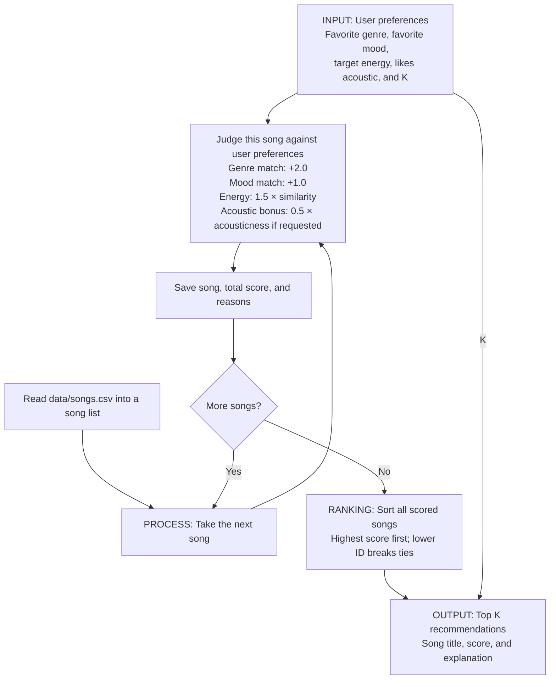

# 🎵 Music Recommender Simulation

## Project Summary

In this project you will build and explain a small music recommender system.

Your goal is to:

- Represent songs and a user "taste profile" as data
- Design a scoring rule that turns that data into recommendations
- Evaluate what your system gets right and wrong
- Reflect on how this mirrors real world AI recommenders

Replace this paragraph with your own summary of what your version does.

---

## Designing the Simulation: Define Your Data

The original catalog contains 10 songs across pop, lofi, rock, ambient, jazz, synthwave, and indie pop. Its moods are happy, chill, intense, relaxed, moody, and focused. Energy ranges from 0.28 to 0.93 on a 0.0–1.0 scale, where higher values mean greater intensity.

### Dataset expansion prompt

```text
Generate 8 additional fictional songs for a music recommendation simulation.
Return only valid CSV with this exact header and column order:
id,title,artist,genre,mood,energy,tempo_bpm,valence,danceability,acousticness

Use unique integer IDs 11 through 18 and invent song titles and artist names.
Use these eight genres once each: soul, folk, salsa, country, classical,
hip hop, metal, reggae. Use these eight moods once each: melancholic,
reflective, festive, nostalgic, solemn, confident, defiant, hopeful.
These genres and moods expand beyond those in the original catalog.
Keep energy, valence, danceability, and acousticness between 0.0 and 1.0.
Use plausible positive tempo_bpm values and vary the numerical features
to represent different listening experiences. Treat all values as invented
simulation estimates, not measured audio characteristics. Quote any CSV field
that contains a comma, quotation mark, or newline. Do not include commentary
or Markdown fences in the output.
```

The expanded `data/songs.csv` contains 18 songs. Rows 11–18 are fictional examples with illustrative feature values, rather than measurements of real recordings. The original 10 rows and CSV headers are preserved.

### Numerical features

The starter file already includes several useful numerical features:

| Feature | Scale | Meaning |
| --- | --- | --- |
| Energy | 0–1 | Perceived intensity, from gentle to powerful. |
| Tempo | Beats per minute | Speed of the musical beat. |
| Valence | 0–1 | Musical positivity, from darker to more upbeat. |
| Danceability | 0–1 | How suitable the rhythm is for dancing. |
| Acousticness | 0–1 | How acoustic the recording sounds. |

Possible additional features for a later version are:

| Proposed feature | Scale | Potential use |
| --- | --- | --- |
| Instrumentalness | 0–1 | Favor songs without vocals for a listener who wants instrumental music. |
| Speechiness | 0–1 | Match a preference for more or less spoken-word content. |
| Liveness | 0–1 | Match a preference for a live-performance sound. |
| Duration | Seconds, greater than 0 | Match a preferred song length or help build a playlist of a target duration. |

These proposed columns are design ideas and have not been added to the CSV. Before using them, define consistent values and update the song model and loader. For scoring, compare each value with the listener's target; normalize duration and tempo before combining them with 0–1 features so larger units do not dominate the score.

## Designing the Simulation: Create a User Profile

This profile represents a listener choosing calm background music for studying. They prefer chill lofi, low-to-moderate energy, and an acoustic sound, with a moderate beat and a slightly positive mood.

```python
user_prefs = {
    "favorite_genre": "lofi",
    "favorite_mood": "chill",
    "target_energy": 0.40,
    "likes_acoustic": True,
    "target_tempo_bpm": 80,
    "target_valence": 0.60,
    "target_danceability": 0.50,
}
```

The first four keys match the preferences in the planned scoring rule below. `likes_acoustic` expresses a preference for greater acousticness rather than a specific numerical target. The remaining three keys record targets for existing CSV features for future experiments; the current scoring design does not use them, and they are not fields in the starter `UserProfile` class. Instrumentalness, speechiness, liveness, and duration can be considered after those proposed features are added to the dataset. This dictionary is a design example; the starter app has not yet been updated to use it.

### Critique of the profile

The profile can clearly distinguish intense rock from chill lofi because genre, mood, and energy provide separate comparison signals. Applying the planned scoring rule by hand gives:

| Song | Genre / mood / energy | Genre points | Mood points | Energy points | Acousticness bonus | Total |
| --- | --- | --- | --- | --- | --- | --- |
| Midnight Coding | lofi / chill / 0.42 | 2.00 | 1.00 | 1.470 | 0.355 | 4.825 |
| Storm Runner | rock / intense / 0.91 | 0 | 0 | 0.735 | 0.050 | 0.785 |

For example, Midnight Coding earns `1.5 * (1 - abs(0.42 - 0.40)) = 1.47` energy points. These are expected scores from the design, not output from the unfinished recommender.

The profile is specific enough for a study session, but too narrow to represent all of a listener's tastes. Exact genre and mood matches strongly favor lofi labeled chill; a similarly gentle ambient or jazz song receives no genre bonus even if it suits studying. Also, an acousticness bonus does not guarantee a song has no distracting vocals, and the tempo, valence, and danceability targets have no effect until their scoring rules are added.

A later version could accept several preferred genres and moods, give partial credit for related categories, and support separate study and workout profiles. Numerical preferences should reward closeness rather than require exact matches. Keep preferences as scoring signals rather than hard filters so unfamiliar songs can still appear, and adjust the weights after reviewing the recommendations.

## How The System Works

The planned recommender compares each song with a user's taste profile, gives it a compatibility score, and recommends the highest-scoring songs. The rules below describe the design; the starter recommendation functions still need to be implemented.

Each `Song` stores an ID, title, artist, genre, mood, energy, tempo in beats per minute, valence (musical positivity), danceability, and acousticness. This scoring recipe uses genre, mood, energy, and acousticness. The ID identifies the song and breaks score ties, while the title and artist identify it in the results. The remaining features are available for future experiments.

The `UserProfile` stores four preferences:

- `favorite_genre`: the user's preferred genre.
- `favorite_mood`: the user's preferred mood.
- `target_energy`: the user's preferred energy level, from 0 to 1.
- `likes_acoustic`: whether to give more acoustic songs a bonus. A value of `False` means no acoustic preference.

### Scoring logic design

The attributes in `data/songs.csv` support several point-weighting strategies. Each strategy below uses exact genre and mood matches, energy similarity `1 - abs(song.energy - user.target_energy)`, and an optional acousticness bonus. The numerical columns use a 0–1 scale, so their weights set their maximum point contributions.

| Strategy | Genre match | Mood match | Energy similarity weight | Acousticness weight | Tradeoff |
| --- | --- | --- | --- | --- | --- |
| Genre-led | 3.0 | 1.0 | 0.5 | 0.5 | Strongly favors familiar genres, even when intensity is less suitable. |
| Mood-led | 1.0 | 2.0 | 1.5 | 0.5 | Prioritizes the listening occasion and allows more genre variety. |
| Balanced (final choice) | 2.0 | 1.0 | 1.5 | 0.5 | Gives genre the strongest individual signal while allowing energy and mood to influence the result. |

These are design alternatives, not measured experiment results. The final recipe preserves the earlier 4:2:3:1 proportions at half the point scale, so its rankings are unchanged. Weights belong in the scoring rule rather than in the CSV: song attributes stay fixed, while a song's score depends on the user's profile.

### Finalized Algorithm Recipe

1. Read the songs from `data/songs.csv` and the user's genre, mood, energy, and acoustic preferences.
2. Loop through every song, starting its score at zero. Apply the four scoring rules below and record the reasons for its points.
3. Save each song with its total score and reasons.
4. Sort all songs by total score from highest to lowest, breaking ties by lower song ID. Use full precision when sorting.
5. Return the top `k` songs (5 by default), or all songs if fewer are available, with their scores and explanations.

For each song, use these finalized weights:

| Feature | Rule | Maximum points |
| --- | --- | --- |
| Genre | Award 2.0 points for a match, ignoring capitalization and surrounding whitespace; otherwise award 0. | 2.0 |
| Mood | Award 1.0 point for a match, ignoring capitalization and surrounding whitespace; otherwise award 0. | 1.0 |
| Energy | Award `1.5 * (1 - abs(song.energy - user.target_energy))`. | 1.5 |
| Acousticness | Award `0.5 * song.acousticness` when `likes_acoustic` is `True`; otherwise award 0. | 0.5 |

Genre counts twice as much as mood because this design treats genre as the strongest preference. A perfect energy match earns 1.5 points, so intensity matters more than mood alone but less than genre alone. Mood and energy together can outweigh a genre match, allowing a suitable song from another genre to compete. Acousticness provides a smaller bonus and only applies when requested. Tempo, valence, and danceability contribute no points in this recipe. These weights are the finalized starting design and can be revisited after evaluating recommendations.

Add the four contributions to get the total score. Require song energy, target energy, and acousticness to be between 0 and 1. The total score then ranges from 0 to 5, or 0 to 4.5 when `likes_acoustic` is `False`. The energy rule rewards closeness rather than simply rewarding higher energy. For example, with a target energy of 0.70, a song with energy 0.65 earns `1.5 * (1 - 0.05) = 1.425` energy points, while a song with energy 0.90 earns `1.5 * (1 - 0.20) = 1.20` points. An exact energy match earns 1.5 points, and a difference of 1.0 earns 0. Keep full precision for ranking and round only for display.

The ranking rule scores every song, sorts the songs by total score from highest to lowest, and returns the top `k` songs (5 by default). If two songs have the same score, the song with the lower ID comes first so the results are predictable. If fewer than `k` songs are available, all available songs are returned.

We need both rules because scoring measures how well one song fits the user, while ranking compares those scores to choose a list of recommendations. Following clean code principles, scoring and ranking should have separate responsibilities, and weights should use named constants so they are easy to understand and adjust.

### Expected biases

This system may over-prioritize genre because a genre match earns twice as many points as a mood match, pushing down great songs from other genres that fit the user's mood. Exact genre and mood labels also miss similarities such as "chill" versus "relaxed." The small catalog gives some tastes more choices than others: lofi has three songs, while many genres have only one. When enabled, the acousticness bonus favors acoustic recordings even though electronic music can also suit studying. These are expected limitations of the design, not findings from completed evaluation.

### Visualize the design: data flow

This map is a planning aid for the scoring and ranking logic before implementation.



For example, the CSV row for **Midnight Coding** becomes one song in the loop. With the study profile above (lofi, chill, target energy 0.40, acoustic preference enabled), it earns `2.0 + 1.0 + 1.47 + 0.355 = 4.825` points. Save that song with its score and reasons, then repeat for every remaining song. Only after all songs are scored do we sort the full list and select the top K; Midnight Coding appears in the output if its rank is within K.

---

## Getting Started

### Setup

1. Create a virtual environment (optional but recommended):

   ```bash
   python -m venv .venv
   source .venv/bin/activate      # Mac or Linux
   .venv\Scripts\activate         # Windows
   ```

2. Install dependencies

```bash
pip install -r requirements.txt
```

3. Run the app:

```bash
python -m src.main
```

### Running Tests

Run the starter tests with:

```bash
pytest
```

You can add more tests in `tests/test_recommender.py`.

---

## Sample Recommendation Output

Running `python -m src.main` from the project root produces:

```text
============================================================
MUSIC RECOMMENDER
============================================================
Loaded songs: 18
Profile: genre=pop | mood=happy | energy=0.80

Top 5 recommendations
------------------------------------------------------------
1. Sunrise City - Neon Echo
   Final score: 4.470
   Reasons:
     - genre match (+2.0)
     - mood match (+1.0)
     - energy similarity (+1.470)

2. Gym Hero - Max Pulse
   Final score: 3.305
   Reasons:
     - genre match (+2.0)
     - energy similarity (+1.305)

3. Rooftop Lights - Indigo Parade
   Final score: 2.440
   Reasons:
     - mood match (+1.0)
     - energy similarity (+1.440)

4. Concrete Crown - Verse Atlas
   Final score: 1.485
   Reasons:
     - energy similarity (+1.485)

5. Night Drive Loop - Neon Echo
   Final score: 1.425
   Reasons:
     - energy similarity (+1.425)
```

Sunrise City ranks first because it matches both pop and happy, with energy
0.82 close to the target of 0.80. Gym Hero matches pop but not happy, while
Rooftop Lights matches happy but not pop, so they rank second and third.
Scores are rounded to three decimal places for display; ranking uses full precision.

---

## Experiments You Tried

Use this section to document the experiments you ran. For example:

- What happened when you changed the weight on genre from 2.0 to 0.5
- What happened when you added tempo or valence to the score
- How did your system behave for different types of users

---

## Limitations and Risks

Summarize some limitations of your recommender.

Examples:

- It only works on a tiny catalog
- It does not understand lyrics or language
- It might over favor one genre or mood

You will go deeper on this in your model card.

---

## Reflection

Read and complete `model_card.md`:

[**Model Card**](model_card.md)

Write 1 to 2 paragraphs here about what you learned:

- about how recommenders turn data into predictions
- about where bias or unfairness could show up in systems like this


